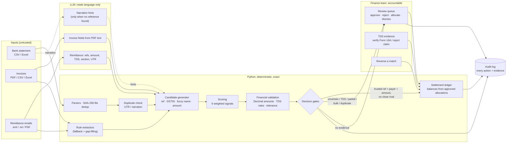

# ReconcileAI architecture

How the prototype divides work between the language model, deterministic code and people. It also covers how each decision can be traced, and where the design is weakest.

## Where AI, code and humans act

## Design decisions

**Exact versus probabilistic.**
- **Probabilistic:** reading free text. This means invoice PDFs, remittance emails and bank narrations.
- **Exact:** every amount, comparison, tax rate and balance. These use Python `Decimal` and fixed rules (`validation/financial_rules.py`, `validation/settlement.py`).
- **Where they meet:** the only bridge between the two is the candidate generator. LLM output becomes *candidate signals* that are verified against the ledger. A model-extracted invoice number that doesn't exist matches nothing. A model-extracted amount is never posted; the bank credit is.

**Why not one LLM call ("match these payments to these invoices")?**
- It can't be audited: there's no stable reason for the choice.
- It can't be reproduced, so the same input could get a different posting tomorrow.
- It is unsafe with money, because a fluent wrong answer looks the same as a right one.

**Why not rules only?**
- Rules alone cover clean references and exact amounts, which is about 44 % of credits in the test split.
- The remainder is language: "we have remitted ₹1,04,400 after TDS u/s 194C against bills 412 and 413", or a narration truncated to "ORBIT LOGISTI-AGAINST BILL 0045".
- The design uses the LLM only for that remainder, and always backs it with a regex extractor. So the system degrades gracefully with no API key, or when the model fails.

**Where knowledge lives.**

| Knowledge | Lives in | When it goes stale |
|---|---|---|
| TDS rates by effective date, tolerance, duplicate window | `config/thresholds.py` (code, versioned) | A rate change needs a config change + redeploy. Nothing retrieves it automatically. |
| How much each signal is worth, and when to auto-match | `config/thresholds.py` and the gates in `decision_engine.auto_block_reason` | Changed by code review. Learned weights are opt-in. |
| Which invoice a vague payment belongs to | The reviewer | Rejections are remembered per credit, so the engine never re-proposes a rejected invoice. |
| Language patterns of narrations and emails | The LLM + regex | New bank formats show up as review-queue volume, not as wrong postings. |

**Traceability.** Every decision can be traced back:
- **Allocations:** each has a deterministic explanation built only from evidence ("invoice reference INV-001 appears in the bank narration; ₹1,18,000 equals the outstanding…"), a confidence score, and settlement components (bank credit + TDS + section + status).
- **Audit log:** every import, model extraction (raw output stored in `extractions`), automatic decision and human action is written there with its actor.
- **Balances:** invoice balances are recomputed from approved allocations, never edited, so any balance can be rebuilt from the allocation history.

**Human in the loop where the law needs one.** TDS is a tax matter, and a deduction is only creditable with the deductor's certificate (Form 16A, cross-checked against 26AS). So the system never treats TDS as settled on its own. It records the claim as *claimed* or *evidence pending*, routes the payment to review, and only a person can mark it *verified* (optionally attaching the certificate) or *reject* it, which re-opens the invoice for the deducted amount. The reviewer's name is recorded on every decision. The tool proposes; the finance team posts.

## Why gates, not just a score

A score trades signals against each other, so a strong amount match could outvote a wrong payer. Auto-posting therefore also requires hard conditions: a trusted invoice reference, a matching payer, an amount that fits a capped tolerance, no TDS, and a confirmed invoice. Weights calibrated on synthetic data had lowered the auto threshold far enough to post a payment from an unrelated payer, so they are now opt-in.

## Weakest points

1. **Synthetic evaluation.** The generator encodes guesses about bank narration formats. Real statements will contain layouts the parser misses; auto-match rates could drop sharply.
2. **Fuzzy customer identity.** A payer truncated to one word ("APEX") can match the wrong group company. The invoice-number gate limits the damage.
3. **Trust in documents.** A forged advice with the right UTR and amount can supply an invoice number. Amounts always come from the bank line.
4. **Single-node SQLite.** Writes are serialised and atomic, which suits a small team. High volume or several servers would need a server database.
5. **Access control is basic.** HTTP Basic with three roles; no single sign-on, and no rule that the preparer and approver differ.

## Considered and rejected

- **Letting the LLM decide matches.** Rejected for the auditability and reproducibility reasons above.
- **Embedding similarity / retrieval over invoices.** The decisive signals (invoice number, amount, GSTIN) are exact tokens, where string and number matching beats vectors.
- **Proportional splitting of bulk payments by default.** The engine proposes full settlement of each invoice whose balances add up to the credit, and asks a human.
- **Auto-posting part-payments.** A shortfall can be TDS, a dispute or an error, so a person decides.
